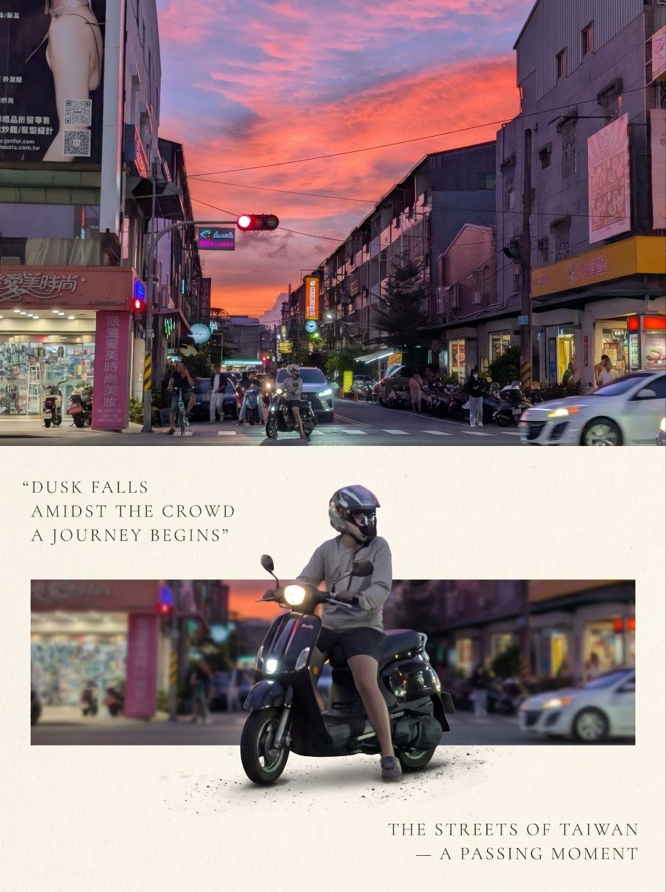
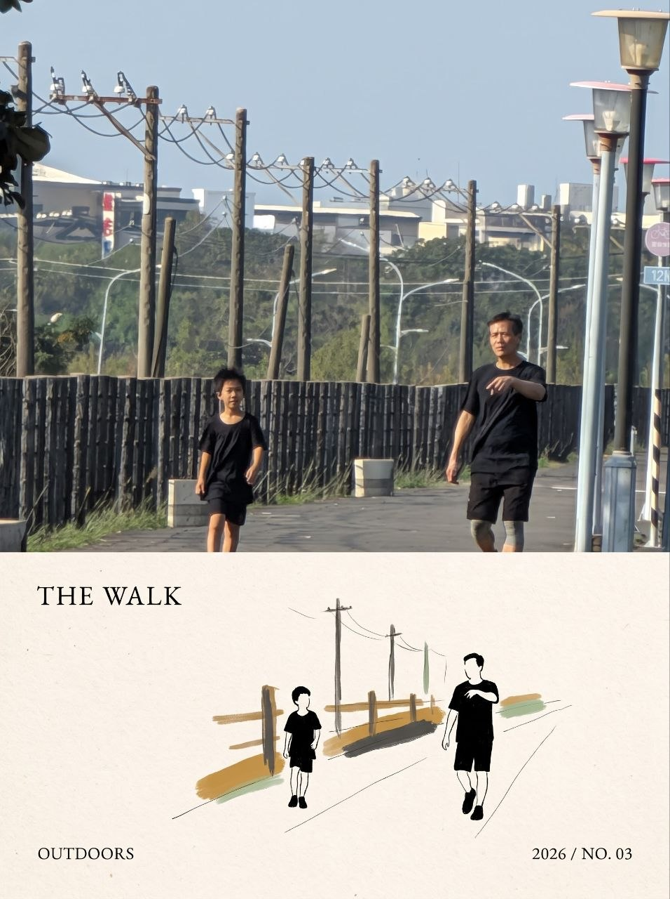
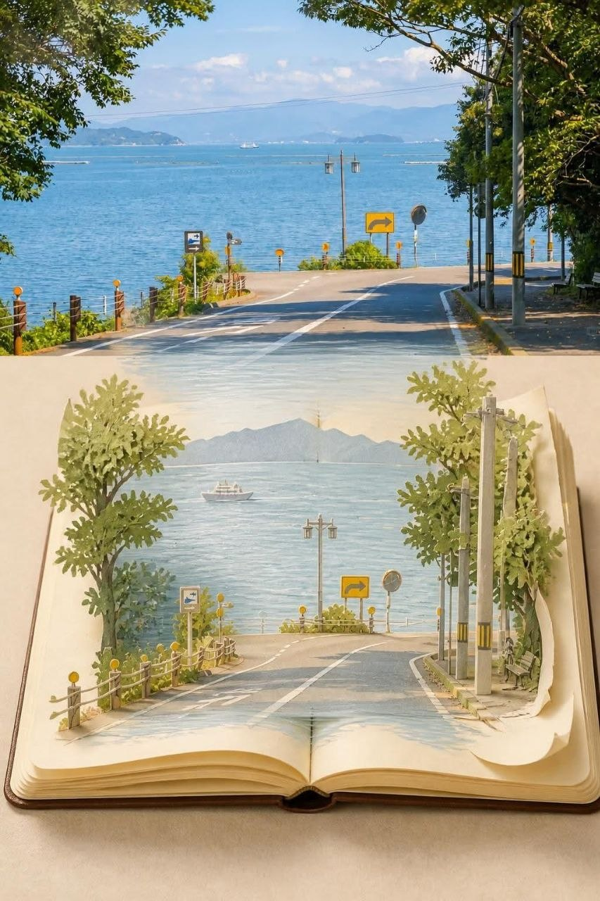
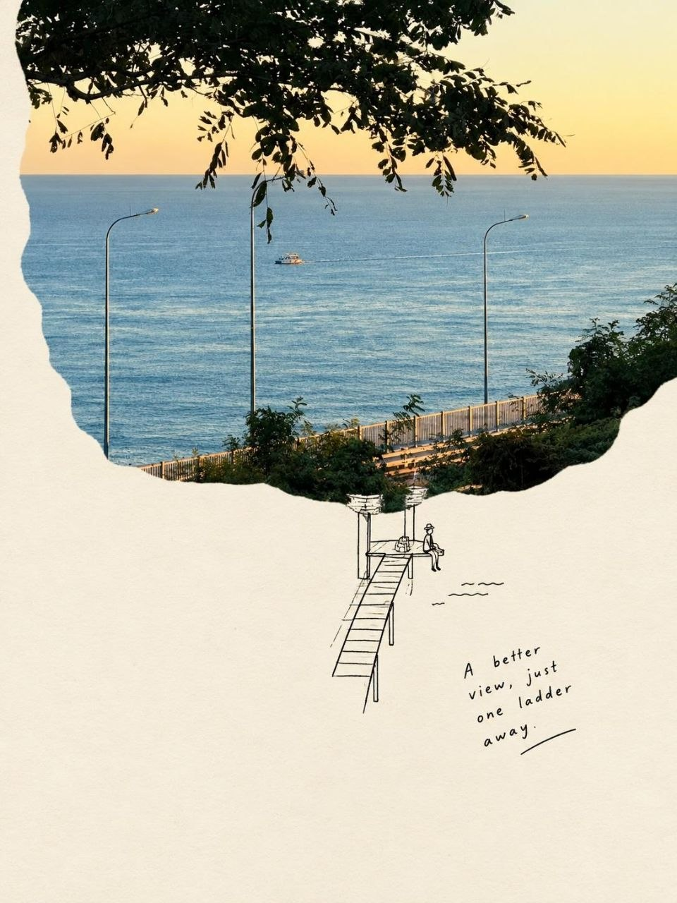
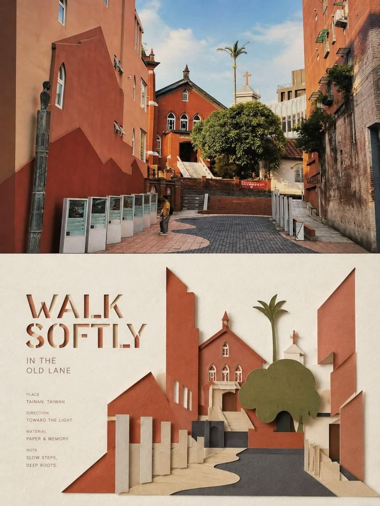
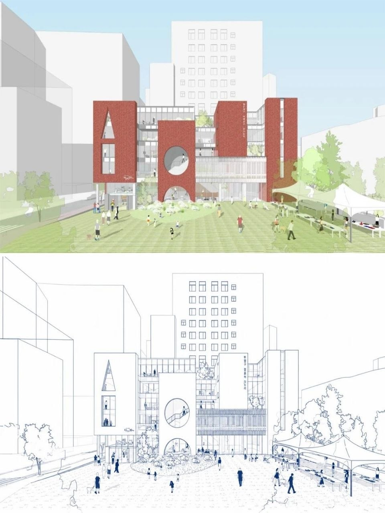
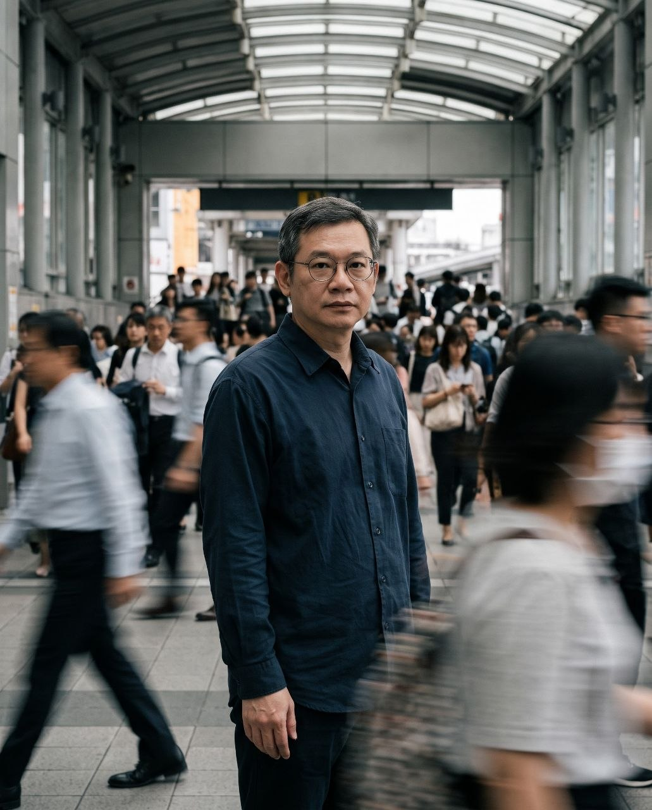
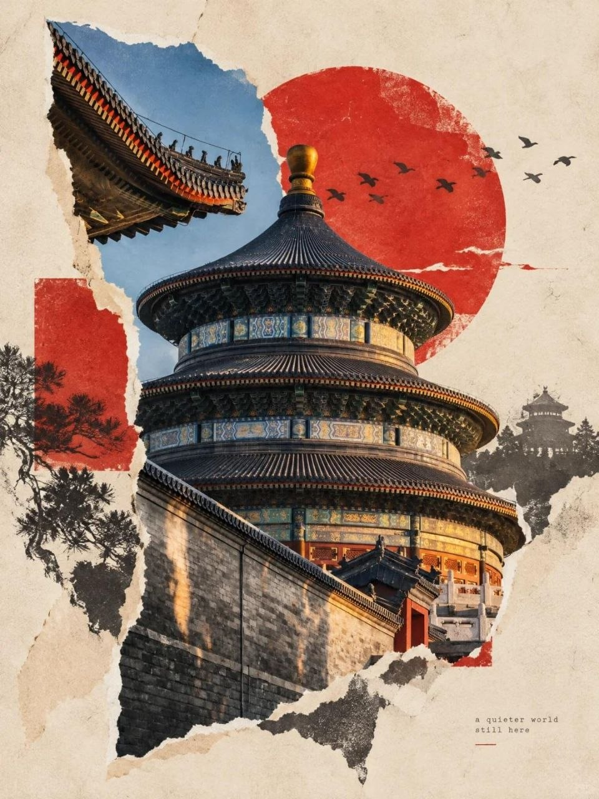

# Prompt Collector · AI 視覺提示詞庫

本庫收錄高質感 AI 圖像生成（Midjourney / Flux / SD）標準化提示詞，全案採用 **五模組標準英文架構 (5-Part Modular Schema)**。

## CASE-01 · 3:4 畫廊風 3D 破框海報 (Gallery Split 3D Pop-out)

**標籤**：`圖像生成` `海報設計` `視覺排版` `3D破框`  

**說明**：以原照片無縫對接，下半部暖米白紙張背景上主體局部放大並打破橫向模糊小窗（3D破框），底部柔和漸變融入紙面。



### 英文提示詞 (Prompt)
```text
[FORMAT & RATIO]
3:4 vertical poster, horizontally split into top and bottom halves touching seamlessly, no white line, gap, or border.

[TOP HALF — PHOTO REALISM]
Full-bleed display of the uploaded original photograph, preserving authentic perspective, natural sunlight, and environmental details.

[BOTTOM HALF — 3D POP-OUT & RECONSTRUCTION]
- Background: Warm off-white textured fine art paper.
- Subject: The main subject is precisely cut out, enlarged, and centered.
- 3D Pop-out: Behind the subject sits a thin horizontal rectangular frame showing a softly blurred crop of the original scene. The subject punches forward through the frame, breaking the boundary.
- Base Transition: Base of the subject softly fades into the paper with natural particles, gentle shadow, and soft reflection.

[EDITORIAL TYPOGRAPHY]
- Top-Left: 3 short poetic lines in small, light-grey uppercase serif font with wide letter-spacing.
- Bottom-Right: 2 minimalist notation lines ending with an em-dash "—".

[NEGATIVE PROMPT & PARAMS]
Avoid: white dividing lines, harsh edges, cartoon style, distorted anatomy, cheap plastic 3D, commercial ads.
Parameters: --ar 3:4 --style raw --v 6.1
```

### 規格解析 (Markdown)

### 🎨 提示詞解析與排版規格說明

* **尺寸比例**：3:4 垂直畫廊海報（Vertical Gallery Poster）。
* **版面結構**：上下精準 1:1 無縫拼接（Seamless Borderless Split），零白邊隔線。
* **上半部 (Top Half)**：滿版呈現原相機照片（Full-bleed Original Photo），保留真實光影。
* **下半部 (Bottom Half)**：
  - **材質底色**：溫暖米白微糙藝術紙（Warm off-white textured paper）。
  - **主體特效**：主體精準摳圖、適度放大並居中。
  - **3D 破框 (Pop-out)**：主體背後置放薄型橫向模糊窗，主體向前破框而出。
  - **底部過渡**：主體底部自然柔和羽化融入紙面，帶細緻微粒與接觸陰影。
* **字體排版 (Typography)**：
  - 左上方：3 行寬字距淺灰大寫襯線詩意短句。
  - 右下方：2 行帶破折號「—」的極簡註記文字。
* **推薦適用模型**：Midjourney v6.1 / Flux.1 [dev] / SD 3.5
* **推薦參數建議**：`--ar 3:4 --style raw --v 6.1`

---

## CASE-02 · 3:4 雜誌風立體紙雕海報 (Layered Paper-cut Diorama & Editorial)

**標籤**：`圖像生成` `海報設計` `紙雕藝術` `雜誌排版` `視覺重構`  

**說明**：以照片無縫拼接，下半部將原場景重構為精細多層次立體卡紙微縮剪紙（Paper-cut Diorama），搭配高級獨立雜誌風格襯線排版。

### 英文提示詞 (Prompt)
```text
[FORMAT & RATIO]
3:4 vertical magazine editorial poster, top and bottom halves joined seamlessly with no white line, border, or gap.

[TOP HALF — PHOTO REALISM]
The uploaded original photograph preserved faithfully without alteration: authentic lighting, realistic texture, and unchanged subjects.

[BOTTOM HALF — PAPERCRAFT DIORAMA]
- Medium & Texture: The identical scene and composition recreated as a layered paper-cut diorama. Textured heavyweight cardstock, crisp cut edges, and soft, natural drop shadows between stacked layers.
- Color Palette: Muted harmonious palette directly sampled from the photo, set against a warm cream paper background.
- Dimensionality: Tangible physical depth with foreground-to-background paper elevation.

[EDITORIAL TYPOGRAPHY]
- Placement: Upper-left corner of the bottom half.
- Title: Large 2-line elegant serif title matching the scene mood.
- Subtitle: Small spaced uppercase subtitle "LANDSCAPE STUDY / 01".
- Supporting: 3 minimal keywords and one short poetic line. Minimal, premium magazine aesthetic.

[NEGATIVE PROMPT & PARAMS]
Avoid: white separating lines, glossy plastic 3D, commercial cartoons, colored pencil textures, heavy digital noise.
Parameters: --ar 3:4 --style raw --v 6.1
```

### 規格解析 (Markdown)

### 🎨 提示詞解析與排版規格說明

* **尺寸比例**：3:4 垂直畫幅，上下 1:1 精確無縫對接。
* **上半部 (TOP)**：忠實保留原片構圖、主體相貌、光影與氛圍，不作扭曲。
* **下半部 (BOTTOM - 立體紙雕微縮)**：
  - **材質**：厚磅紋理卡紙（Textured cardstock）、精緻裁切切口、層層堆疊之立體微投影。
  - **色彩**：自原片萃取之低飽和柔和色盤，基底為奶油白/象牙白紙。
  - **排版系統 (位於左上角)**：
    - 主標題：典雅雙行襯線字體（Serif Title）。
    - 副標題：寬字距微型大寫字 `LANDSCAPE STUDY / 01`。
    - 輔助元素：3 個風格關鍵詞與 1 行極簡詩句。
* **推薦適用模型**：Midjourney v6.1 / Flux.1 [dev] / SD 3.5
* **推薦參數建議**：`--ar 3:4 --style raw --v 6.1`

---

## CASE-03 · 3:4 獨立刊物風極簡手繪紙本海報 (Minimalist Hand-drawn Paper Illustration)

**標籤**：`圖像生成` `海報設計` `極簡手繪` `雜誌排版` `藝術出版` `視覺重構`  

**說明**：上下 1:1 分割。上半部忠實保留原片；下半部以極簡手繪墨線與低彩度壓克力平塗，在大量負空間中重構微縮主體，營造獨立藝術刊物封面感。



### 英文提示詞 (Prompt)
```text
[FORMAT & RATIO]
Strict 3:4 vertical composition, divided horizontally into two exact 1:1 equal halves (top 50%, bottom 50%), seamless borderless connection.

[TOP HALF — PHOTO REALISM]
Faithful preservation of the uploaded photo: original subject pose, proportions, natural lighting, and photographic atmosphere. Subtle editorial color grading of a high-end contemporary art book.

[BOTTOM HALF — MINIMAL PAPER COVER ILLUSTRATION]
- Concept: A small subject surrounded by generous poetic negative space (occupying 10–20% centered).
- Medium: Warm off-white rough handmade paper texture with visible grain. Delicate, slightly imperfect hand-drawn black ink contour lines and restrained flat acrylic/gouache color blocks.
- Palette: Max 4 muted colors directly extracted from the photograph.
- Environment: Highly abstracted with minimal dry-brush strokes and thin ink lines.

[EDITORIAL TYPOGRAPHY]
- Title: Understated elegant serif title "THE WALK".
- Subtitle & Issue: Spaced uppercase category "OUTDOORS" and issue notation "2026 / NO. 03".
- Aesthetic: Evoking independent art publication book covers and quiet picture books.

[NEGATIVE PROMPT & PARAMS]
Avoid: colored pencils, crayons, bleeding watercolor, 3D render, cartoon characters, commercial ads, cluttered details.
Parameters: --ar 3:4 --style raw --v 6.1
```

### 規格解析 (Markdown)

### 🎨 提示詞解析與排版規格說明

* **尺寸比例**：嚴格 3:4 縱向構圖，上下精確 1:1 等分對接（各佔 50%）。
* **上半部 (真實攝影)**：忠實保留人物、光影與透視，施以展覽級高級調色。
* **下半部 (極簡手繪紙本插畫)**：
  - **核心哲學**：大量空白中的微小主體（主體僅佔 10%–20%，居中置放）。
  - **手作媒材**：溫潤米白粗糙紙張、微不完美手繪墨線、壓克力/不透明水彩平塗色塊。
  - **色彩提煉**：直接萃取原相機主色並壓縮至 4 色以內。
* **現代編輯排版**：
  - 標題：襯線體 `THE WALK`
  - 標籤與期號：大寫 `OUTDOORS` 與 `2026 / NO. 03`
* **推薦適用模型**：Midjourney v6.1 / Flux.1 [dev] / SD 3.5
* **推薦參數建議**：`--ar 3:4 --style raw --v 6.1`

---

## CASE-04 · 3:4 旅人手帳立體微縮紙雕海報 (Travel Journal Pop-up Diorama)

**標籤**：`圖像生成` `海報設計` `手帳紙藝` `立體微縮` `空間延伸` `視覺重構`  

**說明**：畫面精準 50/50 分割。上半部真實海景道路；下半部無縫銜接至一本展開的旅行手帳，將道路、標誌、電線桿重構為立體折頁微縮紙雕。



### 英文提示詞 (Prompt)
```text
[FORMAT & RATIO]
3:4 vertical photography derivative poster, strict 1:1 horizontal division (top 50% real world, bottom 50% journal world), seamless spatial continuation.

[TOP HALF — REAL WORLD]
Faithful preservation of the uploaded photo: original coastal road perspective, light and shadows, utility poles, and ocean. Subtle clean editorial color grading.

[BOTTOM HALF — POP-UP TRAVEL JOURNAL]
- Medium & Vehicle: A realistic open travel journal lying on a warm off-white background, showing visible paper thickness, naturally curled page corners, and central book spine.
- Pop-up Diorama: Key architectural and environmental elements from the photo selectively reconstructed as 3D pop-up structures rising from the pages. Built with fold lines, precision cutouts, paper supports, and natural contact drop shadows.
- Detailing: Restrained watercolor wash with architectural ink contours.
- Seamless Transition: The road and shoreline naturally flow across the boundary into the book spine and page fold.

[EDITORIAL TYPOGRAPHY]
No large titles, readable text, or watermarks. Optional 1–3 tiny black silhouette line figures interacting as travelers.

[NEGATIVE PROMPT & PARAMS]
Avoid: simple watercolor filters, flat photo collages, distorted perspective, text/watermarks, cartoon illustration.
Parameters: --ar 3:4 --style raw --v 6.1
```

### 規格解析 (Markdown)

### 🎨 提示詞解析與排版規格說明

* **尺寸比例**：3:4 垂直畫幅，上下嚴格 1:1 等分對接（各佔 50%）。
* **上半部（真實世界）**：忠實保留海邊公路、電線桿與海水光影，微調出版級色調。
* **下半部（書中第二世界）**：
  - **載體**：展開的旅行手帳（具厚度、捲曲頁角與清晰書脊）。
  - **立體微縮紙雕 (Pop-up Diorama)**：萃取原圖景觀，以折頁、切口、支撐結構與自然接觸陰影重構立體空間。
  - **跨界過渡**：海面與柏油路流暢延伸至書頁與書脊，空間無縫流動。
* **推薦適用模型**：Midjourney v6.1 / Flux.1 [dev] / SD 3.5 (Inpaint)
* **推薦參數建議**：`--ar 3:4 --style raw --v 6.1`

---

## CASE-05 · 3:4「第二世界」概念二創海報 (The Second World Doodled Poster)

**標籤**：`圖像生成` `海報設計` `第二世界` `黑線塗鴉` `互動拼貼` `視覺重構`  

**說明**：上下 1:1 分割。上半部真實攝影；下半部米白紙大面積留白，將照片邊緣與元素轉化為可互動結構，配合黑線塗鴉小人與幽默手寫旁白。



### 英文提示詞 (Prompt)
```text
[FORMAT & RATIO]
3:4 vertical poster, strict 1:1 horizontal split (top 50% authentic photo, bottom 50% doodle second world), borderless connection.

[TOP HALF — PHOTO REALISM]
Faithful preservation of the uploaded photo: subject, natural sunlight, reflection, and environmental perspective intact without artificial re-creation.

[BOTTOM HALF — INTERACTIVE SECOND WORLD]
- Background: Warm off-white paper texture with extensive negative space.
- Structural Interaction: The physical structures of the photo (e.g. water edge, road, horizon) transform into interactable entities (piers, ladders, platforms). The cut edge of the photograph actively defines the interaction zone.
- Doodle Figures: 0–3 minimalist black line-art doodle figures actively using the photo structure (climbing, fishing, observing), not merely standing.

[EDITORIAL TYPOGRAPHY]
- Handwritten Commentary: A single short, witty, casual handwritten English caption integrated organically into the negative space (e.g. "A better view, just one ladder away.").

[NEGATIVE PROMPT & PARAMS]
Avoid: mechanical torn paper templates, decorative clutter (random leaves/stars), altered colors, dense characters.
Parameters: --ar 3:4 --style raw --v 6.1
```

### 規格解析 (Markdown)

### 🎨 提示詞解析與排版規格說明

* **尺寸比例**：3:4 垂直畫幅，上下嚴格 1:1 等分對接。
* **上半部（真實攝影）**：忠實保留原片主體、光影與透視，僅作必要裁切。
* **下半部（第二世界）**：
  - **背景**：暖米白紙張質地，大面積留白。
  - **結構互動**：將照片邊界轉化為可互動實體（如木棧道、碼頭、攀爬梯）。
  - **黑線塗鴉小人**：0–3 個極簡手繪人物，真正與照片物理結構互動。
  - **手寫旁白**：幽默自然的簡短英文手寫註解。
* **推薦適用模型**：Midjourney v6.1 / Flux.1 [dev] / SD 3.5 (Inpaint)
* **推薦參數建議**：`--ar 3:4 --style raw --v 6.1`

---

## CASE-06 · 3:4 建築空間手工剪紙與紙雕海報 (Architectural Paper-cut Collage Poster)

**標籤**：`圖像生成` `海報設計` `手工剪紙` `紙雕拼貼` `建築重構` `現代排版`  

**說明**：嚴格 50/50 上下分割。上半部展覽級真實建築攝影；下半部將老街教堂重構為霧面卡紙微縮剪紙，結合鏤空字與現代編輯排版系統。



### 英文提示詞 (Prompt)
```text
[FORMAT & RATIO]
Strict 3:4 vertical editorial poster, exact 1:1 horizontal split (top 50%, bottom 50%), clear division with unified visual continuity.

[TOP HALF — PHOTO REALISM]
Faithfully preserve the original photograph: red brick church architecture, alley perspective, natural sunlight, materials, and authentic atmosphere. Subtle exhibition-grade color grading.

[BOTTOM HALF — PAPERCRAFT RECONSTRUCTION]
- Medium & Texture: Handcrafted architectural paper-cut diorama collage. Matte textured cardstock with visible paper fibers, crisp cut edges, and soft, natural contact drop shadows between stacked layers.
- Palette: Warm ivory and muted terracotta extracted directly from the photo, harmonious and restrained.
- Geometry: Abstracted geometric elevation and facades creating genuine physical depth, like an art photograph of a paper sculpture.

[EDITORIAL TYPOGRAPHY]
- Title: Debossed paper-cutout serif title "WALK SOFTLY".
- Subtitle: Small spaced uppercase "IN THE OLD LANE".
- Metadata Labels: Refined minimal tags (PLACE: TAINAN, TAIWAN / DIRECTION: TOWARD THE LIGHT / MATERIAL: PAPER & MEMORY / NOTE: SLOW STEPS, DEEP ROOTS).
- Integration: Text aligned along paper contours and architectural axes with wide tracking.

[NEGATIVE PROMPT & PARAMS]
Avoid: plastic 3D render, cartoon aesthetics, cheap clipart, gradients, year numbers.
Parameters: --ar 3:4 --style raw --v 6.1
```

### 規格解析 (Markdown)

### 🎨 提示詞解析與排版規格說明

* **尺寸比例**：3:4 豎版畫幅，上下嚴格 1:1 等分對接（各佔 50%）。
* **上半部（原始攝影）**：忠實還原紅磚教堂與老街巷弄光影，展覽級專業調色。
* **下半部（手工剪紙與紙雕）**：
  - **材質**：象牙白/米白底紙、霧面卡紙纖維、俐落邊緣與堆疊接觸自然陰影。
  - **色彩**：低飽和紅磚色與灰褐、橄欖綠，溫暖克制。
  - **現代編輯排版**：
    - 主標題：鏤空/剪紙質感襯線字 `WALK SOFTLY`
    - 副標題：`IN THE OLD LANE`
    - 輔助標籤：`PLACE: TAINAN`、`DIRECTION`、`MATERIAL`、`NOTE`
* **推薦適用模型**：Midjourney v6.1 / Flux.1 [dev] / SD 3.5 (Inpaint)
* **推薦參數建議**：`--ar 3:4 --style raw --v 6.1`

---

## CASE-07 · 專業建築競賽藍圖線稿插畫 (Architectural Competition Vector Line Illustration)

**標籤**：`圖像生成` `建築設計` `競賽線稿` `藍圖美學` `向量插畫` `視覺重構`  

**說明**：保留原建築佈局與透視，轉化為歐洲競賽級純白底深靛藍（#1E3264）向量線稿。實填藍色人物，細線窗格與空氣透視，零陰影雜色。



### 英文提示詞 (Prompt)
```text
[FORMAT & RATIO]
3:4 vertical composition, full canvas vector architectural presentation board.

[SOURCE FAITHFULNESS & PERSPECTIVE]
Faithfully preserve the exact architectural layout, perspective, geometry, and spatial context of the reference building.

[LINEWORK & VECTOR HIERARCHY]
- Linework: Clean, uniform vector lines without hand-jitter, shading, or drop shadows.
- Hierarchy: Medium blue lines for primary building massing; fine delicate lines for fenestration, mullions, and railings; ultra-fine light blue lines for background buildings to establish atmospheric perspective.

[FILL RULES & COLOR PALETTE]
- Strict Monochromatic Palette: Pure Deep Indigo Blue (#1E3264) on Pure White background only. No gradients, grays, or secondary colors.
- Facade: White ground with blue linework, hollow without interior fill.
- Entourage Figures: Solid indigo blue fill with ultra-fine white lines demarcating clothing separations.
- Vegetation: Closed organic contour lines for canopies (white interior), solid blue lines for tree trunks. Minimal stippled hatch for ground lawn texture.

[ATMOSPHERE & PARAMS]
European architectural competition board aesthetic, minimalist blueprint precision, complete detail, zero cast shadows.
Parameters: --ar 3:4 --style raw --v 6.1
```

### 規格解析 (Markdown)

### 🎨 提示詞解析與排版規格說明

* **風格定位**：歐洲建築競賽展板向量線稿（Architectural Competition Vector Illustration）。
* **雙色配色**：嚴格限定深靛藍（`#1E3264`）＋ 純白（`#FFFFFF`），零灰色零漸層。
* **線條粗細分級**：主體外輪廓（中線）> 窗格細部（細線）> 遠景輪廓（極細線，空氣透視）。
* **填充規則**：
  - 建築立面：白底藍線，空心不填充。
  - 人物：深靛藍實填，白細線勾勒服飾。
  - 樹木：閉合線框樹冠留白，實心線幹。
  - 草坪：極細點線紋理。
* **推薦適用模型**：Midjourney v6.1 / Flux.1 [dev] / ControlNet (Lineart/Canny)
* **推薦參數建議**：`--ar 3:4 --style raw --v 6.1`

---

## CASE-08 · 4:5 A24 電影感慢快門人像攝影 (A24 Motion Blur Cinematic Portrait)

**標籤**：`圖像生成` `電影感攝影` `慢快門` `動態模糊` `人像攝影` `A24風格`  

**說明**：胸口視角 Leica SL3 慢快門作品。主體絕對凝止銳利，背景數百通勤人流拉出動態模糊，低飽和混凝土冷色調呈現「冷靜與混亂」A24 電影張力。



### 英文提示詞 (Prompt)
```text
[FORMAT & RATIO]
4:5 vertical framing, eye-level chest shot cinematic portrait.

[CAMERA PROFILE & LIGHTING]
- Camera: Shot on Leica SL3 with 50mm Summilux lens, f/2.8 aperture.
- Technique: Slow shutter panning capture, creating smooth physical motion blur streaks.
- Lighting: Overcast natural soft diffused light as ambient source, gentle prolonged exposure blur without harsh contrast.

[SUBJECT & CROWD DYNAMICS]
- Main Subject: Completely still, sharp direct gaze, symmetrical features, authentic skin texture with visible pores, understated minimalist fashion.
- Crowd: Hundreds of commuters rushing in multiple directions, stretched into smooth horizontal and diagonal motion blur streaks.
- Thematic Contrast: Editorial aesthetic of "Calm vs Chaos", silent rebellion through stillness.

[COLOR PALETTE & FILM GRAIN]
A24-inspired desaturated concrete grey and neutral pale skin tones. Fine organic film grain, clean optical blur physics, zero digital artifacts or face distortion.
Parameters: --ar 4:5 --style raw --v 6.1
```

### 規格解析 (Markdown)

### 🎨 提示詞解析與排版規格說明

* **相機與鏡頭參數**：Leica SL3, 50mm Summilux, f/2.8, 胸口高度平視角度，慢速快門（Slow Shutter Panning）。
* **光影風格**：陰天漫射柔光，避免過硬陰影，提供乾淨物理性模糊軌跡。
* **色彩美學**：A24 電影調色，低飽和混凝土灰冷調搭配中性膚色。
* **視覺核心**：主體絕對靜止與清晰（Sharp Foreground） vs 背景通勤人流高速流動動態模糊（Motion Blur Crowd），體現「冷靜與混亂」對比。
* **推薦適用模型**：Midjourney v6.1 / Flux.1 [dev]
* **推薦參數建議**：`--ar 4:5 --style raw --v 6.1`

---

## CASE-09 · 3:4 混合媒介手撕紙實景拼貼海報 (Mixed Media Torn Paper Collage Poster)

**標籤**：`圖像生成` `混合媒介` `手撕紙拼貼` `絲網印刷` `藝術海報` `視覺重構`  

**說明**：照片以不規則手撕毛邊破入暖米白底紙。結合朱砂紅圓形色塊、黑色松樹飛鳥剪影與極小打字機文字，呈現絲網印刷與獨立藝術誌質感。



### 英文提示詞 (Prompt)
```text
[FORMAT & RATIO]
3:4 vertical mixed media collage poster, continuous perspective and horizon across medium transitions.

[PHOTOGRAPHIC CORE & TORN EDGES]
Preserve the core subject, natural sunlight, and spatial depth. The authentic photograph is shaped with organic, randomized torn deckled paper edges, extending onto a warm off-white textured vintage paper background.

[GRAPHIC SILHOUETTES & SCREENPRINT ACCENTS]
- Hand-drawn Ratio: 30%–35% graphic accents.
- Silhouettes: Simplified black silhouettes (pine trees, flock of birds, distant mountain pagoda) extending the movement of the composition.
- Color Block: A single bold, high-saturation crimson red sun disc behind the architecture creating a strong focal anchor.

[EDITORIAL TYPOGRAPHY]
- Large negative space with a single line of tiny, minimalist typewriter font at the bottom corner (e.g. "a quieter world still here").
- Aesthetic: Screenprint texture, independent art magazine, vintage paper fibers.

[NEGATIVE PROMPT & PARAMS]
Avoid: full-bleed flat photo, dense cluttered doodles, bold headlines, multiple bright colors, logos, watermarks.
Parameters: --ar 3:4 --style raw --v 6.1
```

### 規格解析 (Markdown)

### 🎨 提示詞解析與排版規格說明

* **尺寸比例**：3:4 垂直畫幅拼貼海報（Mixed Media Collage Poster）。
* **手撕紙過渡 (Torn Deckled Edges)**：
  - 照片以隨機不規則毛邊邊緣撕開，主體透視、光線與地平線與背景保持連續。
  - 底紙為暖米白色、帶有纖維質感的復古粗糙紙張。
* **混合媒介重構 (30%~35% 手繪與版畫元素)**：
  - **黑色剪影**：松樹剪影、空中飛鳥群、遠山古剎，延伸空間景深與動線。
  - **單一高飽和色塊**：朱砂紅日輪，借鑒絲網版畫（Screenprint）衝擊力。
  - **微型打字機字體**：右下角留白處極小單行打字機體短句（如 *a quieter world still here*）。
* **推薦適用模型**：Midjourney v6.1 / Flux.1 [dev] / ControlNet
* **推薦參數建議**：`--ar 3:4 --style raw --v 6.1`

---
